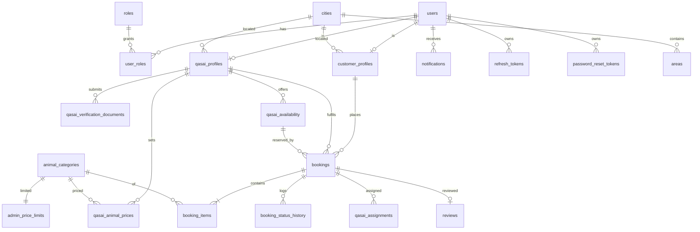

# Database Design (MySQL 8.0, InnoDB, utf8mb4)

Schema is owned by Flyway (`src/main/resources/db/migration`). Hibernate runs with `ddl-auto=validate`.

Key constraints: unique email/phone/CNIC; `UNIQUE(qasai_id, animal_category_id)` on prices; `CHECK service_price > 0`;
`CHECK subtotal = quantity * unit_price`; `UNIQUE(active_availability_id)` (generated) for double-booking prevention;
`UNIQUE(booking_id)` on reviews; `CHECK rating BETWEEN 1 AND 5`.
